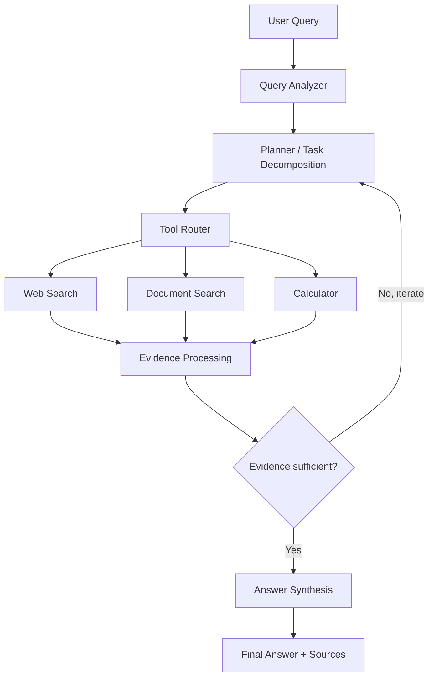

# Agentic AI Research Assistant

A compact, genuinely agentic research assistant: it takes a question, decides
whether it needs tools, plans and executes subtasks, gathers evidence from the
web and/or uploaded documents, checks whether that evidence is sufficient, and
synthesizes a sourced answer — instead of just forwarding your question to an
LLM.

## Overview

Ordinary "LLM chat" answers a question from the model's own training data in
one shot. That's fine for definitions, but it breaks down for anything that
needs current information, arithmetic, or facts buried in a document you just
uploaded — the model either guesses or hallucinates a source.

This project wires an LLM into an actual **agent loop**: it analyzes the
query, decomposes complex questions into subtasks, routes each subtask to the
right tool (web search, calculator, or document search), checks whether the
gathered evidence is actually sufficient, optionally does another research
pass, and only then writes a final answer — with citations back to real
sources.

## Problem

> "What are the latest developments in electric vehicles?"

A single LLM call either declines (no real-time knowledge) or hallucinates
specifics. A research **agent** instead recognizes it needs current
information, calls a web search tool, collects real sources, and writes an
answer grounded in them.

> "What is 4567892 * 213?"

LLMs are unreliable at large arithmetic. A calculator *tool* is exact; the
agent's job is knowing when to reach for it instead of guessing.

> "According to the annual report I just uploaded, what are the main
> financial risks?"

The model has never seen your PDF. The agent needs to retrieve the relevant
passages (RAG over a FAISS index) before it can answer honestly.

## Architecture



The workflow is implemented as a [LangGraph](https://github.com/langchain-ai/langgraph)
`StateGraph` (`app/agent/graph.py`):

```text
START -> analyze_query -> create_plan -> execute_tools -> check_evidence
                                                  ^              |
                                                  |  not enough  |
                                                  +--------------+
                                                                 | sufficient
                                                                 v
                                                      synthesize_answer -> END
```

Simple questions ("What is Python?") skip planning and tool execution
entirely and go straight to synthesis — the agent doesn't manufacture busywork
for questions that don't need it.

### Key modules

| Path | Responsibility |
|---|---|
| `app/agent/` | State, LangGraph workflow, planner, router, evidence processing |
| `app/tools/` | Calculator, web search, document search — the only tools the agent may call |
| `app/retrieval/` | PDF/TXT/MD loading, chunking, embeddings, FAISS vector store |
| `app/llm/provider.py` | Vendor-agnostic LLM interface (OpenAI implementation included) |
| `app/prompts/` | All prompt templates, kept out of business logic |
| `app/models/database.py` | SQLAlchemy models: documents, sessions, tasks, sources, tool executions |
| `app/api/` | Flask blueprints: health, research, documents |
| `app/schemas/` | Pydantic request/response/tool-argument schemas |

### Safety & reliability

- **No `eval()`** — the calculator parses an AST and only allows numeric
  operators.
- **No arbitrary tool execution** — only tools registered in `ToolRegistry`
  can ever be called; the router validates against that registry.
- **Hard limits** — `MAX_AGENT_ITERATIONS`, `MAX_TOOL_CALLS`, `MAX_TASKS`
  prevent infinite loops or runaway costs.
- **Prompt-injection defense** — retrieved web/document content is wrapped
  in explicit "untrusted data" fences (`app/utils/security.py`) before being
  shown to the LLM, and the synthesis prompt tells the model never to treat
  that content as instructions.
- **Graceful degradation** — missing API keys, failed tool calls, empty
  search results, and malformed LLM output are all handled without crashing
  the request; errors are collected and surfaced, not swallowed silently.

## Setup

### Requirements

- Python 3.11+
- An OpenAI API key (for real LLM calls; the app still starts and serves
  `/api/health` without one)
- Optionally, a [Tavily](https://tavily.com) API key for web search

### Installation

```bash
git clone <your-repo-url>
cd agentic-research-assistant

python -m venv venv

# macOS/Linux
source venv/bin/activate
# Windows
venv\Scripts\activate

pip install -r requirements.txt

cp .env.example .env   # Windows: copy .env.example .env
# then edit .env and add your OPENAI_API_KEY
```

### Running

```bash
python run.py
```

The API is now available at `http://localhost:5000`.

### Testing

```bash
pytest
```

All 35 tests run against a mocked LLM and mocked/absent web search — no real
API calls or costs are incurred by the test suite.

### Docker

```bash
docker compose up --build
```

## Environment variables

| Variable | Purpose | Default |
|---|---|---|
| `LLM_PROVIDER` | LLM backend | `openai` |
| `LLM_MODEL` | Model name | `gpt-4o-mini` |
| `OPENAI_API_KEY` | **Required** for real research | _(none)_ |
| `WEB_SEARCH_PROVIDER` | Web search backend | `tavily` |
| `WEB_SEARCH_API_KEY` | Optional; web search fails gracefully without it | _(none)_ |
| `DATABASE_URL` | SQLAlchemy connection string | `sqlite:///data/app.db` |
| `EMBEDDING_MODEL` | sentence-transformers model name | `all-MiniLM-L6-v2` |
| `FAISS_INDEX_PATH` | Where the FAISS index is persisted | `indexes/faiss` |
| `MAX_AGENT_ITERATIONS` | Iterative-research loop cap | `3` |
| `MAX_TOOL_CALLS` | Total tool calls per request | `20` |
| `MAX_TASKS` | Subtasks per request | `15` |
| `MAX_FILE_SIZE_MB` | Upload size cap | `20` |

> **Note on embeddings:** if `sentence-transformers` isn't installed or its
> model weights can't be downloaded, the app automatically falls back to a
> deterministic local embedding so the retrieval pipeline still works
> end-to-end for development. Install `sentence-transformers` and ensure
> internet access to Hugging Face for real semantic search in production.

## API examples

```bash
# Health check
curl http://localhost:5000/api/health

# Ask a question
curl -X POST http://localhost:5000/api/research \
  -H "Content-Type: application/json" \
  -d '{"query": "What are the major advantages and disadvantages of nuclear energy?", "depth": "standard"}'

# Arithmetic
curl -X POST http://localhost:5000/api/research \
  -H "Content-Type: application/json" \
  -d '{"query": "What is 4567 * 892?"}'

# Fetch a past session
curl http://localhost:5000/api/research/<session_id>

# Upload a document
curl -X POST http://localhost:5000/api/documents/upload \
  -F "file=@annual_report.pdf"

# Search uploaded documents directly
curl -X POST http://localhost:5000/api/documents/search \
  -H "Content-Type: application/json" \
  -d '{"query": "major financial risks", "top_k": 5}'

# Ask a question grounded in an uploaded document
curl -X POST http://localhost:5000/api/research \
  -H "Content-Type: application/json" \
  -d '{"query": "According to the uploaded document, what are the main financial risks?"}'
```

## Evaluation

```bash
python scripts/evaluate_agent.py --dry-run   # inspect the eval set, no LLM needed
OPENAI_API_KEY=... python scripts/evaluate_agent.py
```

Reports tool-selection accuracy, average tool calls per query, citation
coverage, and failure rate — all computed from the actual run, never
fabricated — plus a side-by-side comparison against a single-call LLM
baseline on the same queries.

## Production considerations (not implemented, by design)

This is a portfolio-scale project; the following would be next steps for a
real deployment rather than things it currently does:

- Authentication / API keys per client
- Rate limiting
- HTTPS termination (reverse proxy / load balancer)
- Secret management (Vault, AWS Secrets Manager, etc.) instead of `.env`
- Async task workers (Celery + Redis) so research runs don't block a request
- PostgreSQL instead of SQLite for concurrent write access
- Object storage (S3) for uploaded documents instead of local disk
- Observability: structured tracing, metrics, alerting

## Project structure

```text
agentic-research-assistant/
├── app/
│   ├── api/            # Flask blueprints
│   ├── agent/           # State, graph, planner, router, evidence
│   ├── tools/            # calculator, web_search, document_search
│   ├── retrieval/        # loader, chunker, embeddings, vector_store
│   ├── llm/              # provider abstraction
│   ├── prompts/          # all prompt templates
│   ├── models/           # SQLAlchemy models
│   ├── schemas/          # Pydantic schemas
│   └── utils/            # logging, security
├── tests/
├── scripts/evaluate_agent.py
├── data/uploads/
├── indexes/faiss/
├── Dockerfile
├── docker-compose.yml
├── requirements.txt
├── .env.example
├── INTERVIEW_NOTES.md
└── run.py
```

See `INTERVIEW_NOTES.md` for a full Q&A walkthrough of the design decisions
behind this project.
